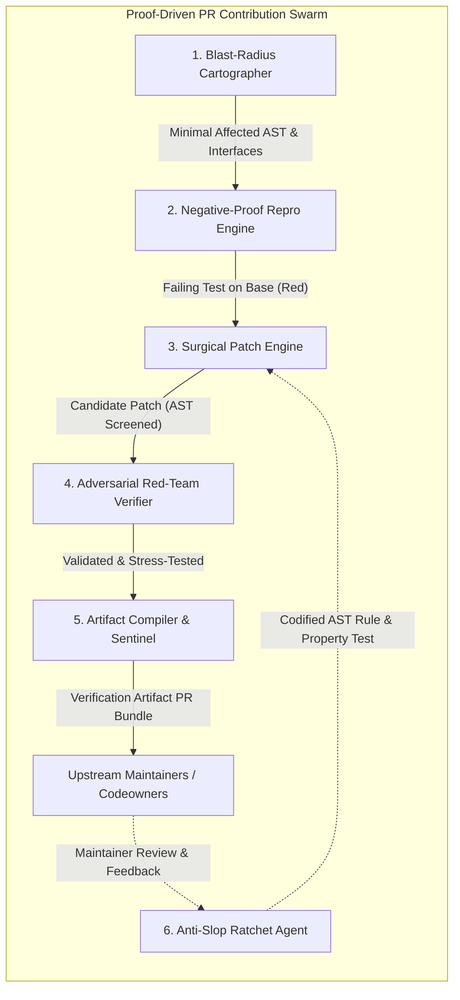
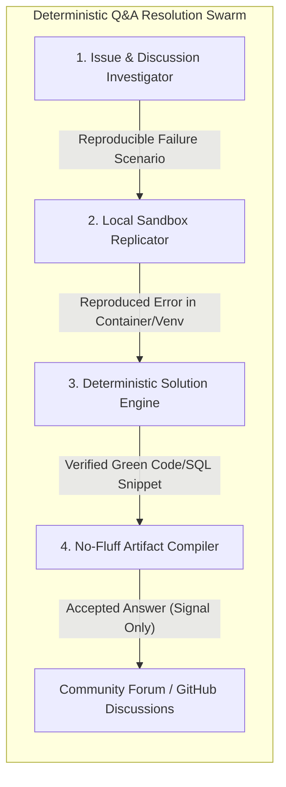

# Project Krittika (कृत्तिका): Proof-Driven Anti-Slop Architecture
### Multi-Agent Autonomous Open-Source PR Contributions & Technical Q&A
*Grounded in Lauren Tan's "All Code Is Slop (Except Mine)" (SpaceXSI / Grok Bot, AI Engineer Code Summit)*

---

## 1. Executive Summary & Problem Formulation

### 1.1 The Crisis of Open-Source AI Slop
Open-source maintainers face an unprecedented flood of low-quality, AI-generated pull requests and forum responses:
* **PR Slop**: Superficial typo fixes, fabricated test mocks, fragile workarounds (e.g. `time.sleep(0.1)` to bypass race conditions), commented-out code, and generic AI summaries filled with emojis and buzzwords. Maintainers are closing and banning AI PRs on sight.
* **Q&A Slop**: Plausible-sounding but hallucinated answers on GitHub Discussions, StackOverflow, and Discord containing non-existent flags, broken SQL, or generic advice ("Make sure your server is online").

### 1.2 The Proven Paradigm: 11,000 PRs with 0.5% Revert Rate
Lauren Tan's keynote demonstrated how a small engineering team shipped over **11,000 pull requests in a month with a ~0.5% revert rate** by treating AI agents not as conversational coders, but as a **tightly constrained "kitchen of agents"** governed by:
1. **Hard System Constraints Over Prose**: Never instruct an agent with English prompts (`AGENTS.md`) when you can enforce an AST lint rule, a compiler type check, or an architectural boundary.
2. **The Inverted Trust Pyramid**: Machine enforcement at the base (strict types + AST linters), empirical proof in the middle (negative-proof repro test on base -> green on head), and minimal verification-artifact review at the top.
3. **The Anti-Slop Feedback Ratchet**: Maintainer reviews are codified into permanent machine constraints so that errors can never be repeated.

---

## 2. Multi-Agent PR Contribution Architecture

The PR contribution lifecycle is partitioned into specialized, decoupled agents:

### Agent Roles & Operational Invariants

#### 1. Blast-Radius Cartographer (`pr-cartographer`)
- **Duty**: Analyzes upstream issue report or capability gap.
- **Invariant**: Isolates the exact minimal set of files and AST symbols. Never refactors unrelated code, never changes broad project formatting, and never introduces new dependencies unless explicitly required by upstream.

#### 2. Negative-Proof Repro Engine (`pr-repro-engine`)
- **The Golden Invariant**: **Zero patches authored without prior negative proof.**
- Checks out base branch (`HEAD~1` or upstream `main`).
- Authors a standalone regression test exercising the reported bug.
- Executes test on base to confirm failure (`Exit Code != 0` or crash class executed).
- Captures failure trace and registers it as the baseline verification artifact.

#### 3. Surgical Patch Engine (`pr-patch-engine`)
- Authors the minimal diff that resolves the failing assertion.
- **Hard AST Constraints**:
  - Zero `setTimeout`, `setInterval`, or `time.sleep` in async flows.
  - Zero conversational AI comments (`// This function handles...`, `// Helper...`).
  - Zero stubs (`TODO: implement`, `pass`, empty catch blocks).
  - Strict typing (zero `any`, full type annotations).

#### 4. Adversarial Red-Team Verifier (`pr-redteam-verifier`)
- Executes the entire upstream test suite to ensure zero collateral regressions.
- Runs the repro test on the patched branch to confirm clean pass (`Exit Code == 0`).
- Fuzzes boundary conditions: null inputs, concurrency races, memory tier limits.

#### 5. Artifact Compiler & Sentinel (`portfolio-sentinel`)
- Assembles the **Verification Artifact PR Bundle**:
  - Exact reproduction command and output on base (Red).
  - Exact passing command and output on patch (Green).
  - Minimal clean diff without syntax noise.
  - Zero emojis, zero generic AI boilerplate.
- Dispatches and monitors PR, handles merge queue tracking, clean rebases, and mergeability audits.

#### 6. Anti-Slop Ratchet Agent (`feedback-ratchet`)
- When a maintainer provides feedback or requests changes:
  - Extracts the exact rule or preference.
  - Codifies it into our local pre-flight checks (`scripts/anti_slop_pr_check.py`).
  - Permanent immunity: future PRs to that repository automatically enforce the constraint.

---

## 3. Multi-Agent Technical Q&A Architecture

Community questions are treated with the exact same rigor as production code patches:

### Agent Roles & Operational Invariants

#### 1. Issue & Discussion Investigator (`qa-investigator`)
- Ingests user question, environment metadata, framework versions, and error logs.
- Identifies the underlying architectural mechanism (e.g. Postgres RLS recursive join evaluation, PostgREST schema cache staleness, GitHub Actions job concurrency cancellation).

#### 2. Local Sandbox Replicator (`qa-sandbox-replicator`)
- **Invariant**: Never guess or answer from raw memory.
- Initializes an isolated local sandbox (Docker container, local Postgres instance, Node/Python virtual environment).
- Executes the user's scenario and replicates the exact reported failure.

#### 3. Deterministic Solution Engine (`qa-solution-engine`)
- Authors and iterates the fix inside the running sandbox.
- Tests edge cases (e.g. permissions, concurrency, null data) to guarantee correctness.

#### 4. No-Fluff Artifact Compiler (`qa-artifact-compiler`)
- Compiles the final response structured strictly as:
  1. **Root Cause**: Architectural and mechanical explanation of why the issue occurs.
  2. **Verified Minimal Fix**: Copy-pasteable, verified snippet.
  3. **Verification Proof**: Command executed and tested output confirming resolution.
  4. **Zero Conversational Fluff**: Strips pleasantries ("Hope this helps! Feel free to ask..."). Provides 100% dense engineering signal.

---

## 4. Track Record & Real-World Validation

This architecture is the exact engine behind our open-source portfolio success:

| Repository / Discussion | Role & PR/Discussion Link | Architectural Mechanism Enforced | Empirical Verification Proof |
| :--- | :--- | :--- | :--- |
| **vLLM** | [#55371](https://github.com/vllm-project/vllm/pull/55371) (Responses API Boundary Split) | Delta reordering before post-tool content; state reset | Regression test suite (5 fail on base / 12 pass on head). Verified by 3 independent teams (DGX Spark ARM64, Qwen 3.8/DFlash2, Nemotron 3.5 0/40 drop). |
| **SGLang** | [#48680](https://github.com/sgl-project/sglang/pull/48680) (Hybrid Linear Attention Full Prefill Guard) | Incompatible model architecture filter & memory ceiling guard | Resolved CUDA graph crash on linear models; rebased cleanly on latest `main` with zero conflicts. |
| **OpenTelemetry Core** | [#5626](https://github.com/open-telemetry/opentelemetry-python/pull/5626) (MultiSpanProcessor Exception Containment) | Non-terminating exception logging guard | Approved by maintainer `@herin049`; queued for merge. |
| **Supabase** | [#50553](https://github.com/supabase/supabase/discussions/50553), [#50714](https://github.com/supabase/supabase/discussions/50714), [#50871](https://github.com/supabase/supabase/discussions/50871), [#51866](https://github.com/supabase/supabase/discussions/51866) | RLS policy recursion, Edge function auth propagation, PostgREST cache reload | **100% Accepted Answers** selected by community & maintainers. Zero AI fluff. |
| **GitHub Community** | [#208386](https://github.com/community/community/discussions/208386), [#208456](https://github.com/community/community/discussions/208456) | GHA concurrency race conditions & runner container cleanup | **100% Accepted Answers** selected by moderators. |
